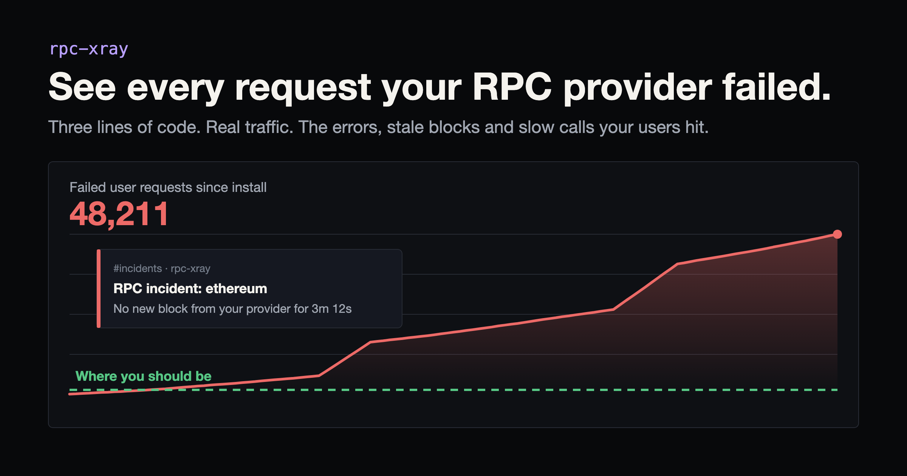

# rpc-xray

**See every request your RPC provider failed.**

Instrument your existing HTTP JSON-RPC client. rpc-xray counts errors and slow calls, measures stale blocks when head probes are enabled, and exports the results to Prometheus.



Your requests pass through untouched. rpc-xray measures each one, exposes Prometheus metrics, and ships a Grafana dashboard, alert rules and Slack incident messages that work as they are.

## Install

Node.js 20 or newer. The package has no runtime dependencies.

```bash
npm install @solidrpc/rpc-xray
```

The npm package is published. For testing unreleased changes, use the [development instructions](#development-and-release-testing).

For an existing viem app:

```ts
import { createPublicClient, http } from "viem";
import { xray, serveMetrics } from "@solidrpc/rpc-xray";

const client = createPublicClient({
  transport: http(url, {
    fetchFn: xray(fetch, { chain: "ethereum", probeIntervalSeconds: 0 }),
  }),
});
await serveMetrics({ host: "127.0.0.1", port: 9464 });
```

Here `url` is your existing endpoint. The explicit chain label and disabled probes keep instrumentation from adding RPC calls. Omit these options to enable chain detection and the default head probes. See [request overhead](#what-it-does-to-your-requests) before choosing.

Start with the [complete plain Node.js example](examples/plain-node/README.md) for a runnable app, `/metrics`, shutdown handling, and matching Prometheus configuration. [Other JavaScript integrations](js/README.md) cover ethers and existing HTTP servers.

## Language SDKs

All four SDKs use the same metric names, labels, histogram buckets, and error classifications. They share the dashboards and alert rules.

| Language | Supported integration | Package | Complete example |
|---|---|---|---|
| [JavaScript / TypeScript](js/README.md) | fetch, viem, ethers | `@solidrpc/rpc-xray` on npm | [Node.js](examples/plain-node/README.md) |
| [Python](python/README.md) | HTTPX sync and async, requests, web3.py HTTPProvider | `solidrpc-rpc-xray` on PyPI, not published yet | [Python](examples/plain-python/README.md) |
| [Go](go/README.md) | `net/http`, `go-ethereum` | `github.com/SolidRPC/rpc-xray/go`, not tagged yet | [HTTP](examples/plain-go/README.md), [go-ethereum](examples/go-ethereum/README.md) |
| [Rust](rust/README.md) | reqwest 0.13, Alloy 2.5 | `solidrpc-rpc-xray` on crates.io, not published yet | [reqwest](examples/plain-rust/README.md), [Alloy](examples/alloy/README.md) |

Each SDK README leads with its intended package install command and includes local package instructions for unreleased versions. Every example has `/metrics`, shutdown handling, and a matching Prometheus config. Run one example at a time on the default port 9464, or assign separate ports and scrape targets.

The new Python, Go, and Rust SDKs are passive by default. They make no discovery or probe calls and do not print offer messages. Supply a chain label explicitly. Application-managed probe observations can enable the same head metrics. JavaScript retains its existing discovery and probe defaults, described below.

## Add it with a coding agent

Paste this prompt into your coding agent, in your project:

```text
Integrate RPC X-Ray using https://github.com/SolidRPC/rpc-xray.

1. Read the root README and the README for the application's language.
   Find the existing HTTP JSON-RPC clients and a supported adapter.
2. Install the language package with the existing package manager. If the
   requested version is not published yet, report that release prerequisite.
   The documented local package is a fallback for pre-release testing.
3. Use the supported HTTP adapter without changing URLs, headers, retries,
   or timeouts. Explain any required call-site changes, including Rust's
   explicit reqwest response wrapper. Keep credentials out of code and logs.
4. Respect the application's request budget. In JavaScript, to add zero RPC calls, set
   probeIntervalSeconds: 0 AND supply the correct chain for every endpoint.
   Explain that head freshness and lag are then unmeasured. Otherwise document
   the eth_chainId detection calls and eth_blockNumber probe overhead.
   Python, Go, and Rust are passive and require explicit chain labels.
5. Expose GET /metrics once per process using the same registry that wraps
   the client. In JavaScript, use serveMetrics for the shared registry or
   export your Xray instance's metrics(). Python and Rust export
   telemetry.metrics() through the application's HTTP server. Go exposes
   telemetry.Handler(). Follow the language's complete server example.
6. Set the Prometheus host, port and metrics_path to the actual endpoint.
   For Docker, use host.docker.internal to reach the host, not localhost.
   Verify the target is UP and metrics advance after real application calls.
7. Run type checks and tests through the actual application client. Use
   local mock RPCs for failures, including compressed JSON-RPC errors,
   client timeouts, HTTP 429/500 with JSON-RPC bodies, and mixed batches.
   Check healthy traffic, missing head measurements, and no-incident
   dashboard states. Do not turn missing data into health. Verify that
   scraping metrics adds zero RPC calls and stop test apps afterward.
8. Report changed files, metrics URL, added RPC overhead, how to stop any
   example process, and clients that could not be wrapped.
```

## Start the monitoring stack

No monitoring stack yet? This starts Prometheus, Alertmanager and Grafana with everything loaded:

```bash
git clone https://github.com/SolidRPC/rpc-xray && cd rpc-xray/stack
docker compose up -d
```

Open [Grafana](http://localhost:3000) (set `GRAFANA_PORT` if 3000 is taken). The stack scrapes your app at `host.docker.internal:9464/metrics`. Start your instrumented app first, then confirm the target is **UP** at [Prometheus targets](http://localhost:9090/targets). Change `stack/targets.yml` when your metrics port differs. If your metrics path differs, also set `metrics_path` in `stack/prometheus.yml`. Do not put RPC URLs or API keys in either file.

Docker Desktop reaches the Mac or Windows host through `host.docker.internal`. On native Linux, bind the app metrics server to a Docker-reachable interface and restrict access, since the host gateway cannot reach loopback. See the [plain Node example](examples/plain-node/README.md#scrape-with-prometheus).

Leave `SLACK_WEBHOOK_URL` unset to run without notifications. To enable Slack, set it in an ignored `stack/.env` file and recreate Alertmanager with `docker compose up -d --force-recreate alertmanager`.

To see the dashboard with sample traffic and scripted incidents before touching your own code:

```bash
(cd ../js && npm ci && npm run build)
RPC_XRAY_TARGETS=./targets.demo.yml docker compose --profile demo up -d
```

The demo uses only local mock servers. Its separate target file scrapes `demo:9464` instead of an absent host app. Stop it with `docker compose --profile demo down` before returning to the default app target. Stopping the monitoring stack does not stop your application or its RPC requests.

Allow two scrapes plus a recording-rule evaluation for rate panels. Rollups first appear at the next five-minute evaluation. Weekly comparisons need accumulated history. No data is not evidence of a healthy endpoint.

Already running Prometheus? Take the files you need:

| File | Use |
|---|---|
| [`alerts/rpc-xray.rules.yml`](alerts/rpc-xray.rules.yml) | Recording and alert rules for Prometheus |
| [`alerts/rpc-xray.prometheusrule.yaml`](alerts/rpc-xray.prometheusrule.yaml) | The same rules for the Prometheus Operator |
| [`alerts/alertmanager.yml`](alerts/alertmanager.yml) | Alertmanager route and Slack messages |
| [`dashboards/rpc-xray.json`](dashboards/rpc-xray.json) | Grafana dashboard |

## What you will see in the first hour

- Your success rate on real traffic, next to where it should be.
- Every failed request, split by kind: HTTP errors, rate limits, timeouts, and errors hidden inside HTTP 200 answers.
- How old each provider's latest block is, and how far it lags behind your other providers.
- A Slack message when an incident opens and another when it ends.

## Incidents

An incident is something a person would have been paged for. Defaults, per chain and provider:

| Incident | Opens when |
|---|---|
| Stale | No new block for 3 minutes |
| Lagging | More than 10 seconds of blocks behind your best source, for 3 minutes |
| Failing requests | More than 5% of requests over 3 minutes return HTTP 4xx or 5xx, are rate limited, time out or never connect |
| Errors at HTTP 200 | More than 5% of requests over 3 minutes return HTTP 200 with a provider error inside |
| Slow | p95 latency above 1 second for 3 minutes |

- Reverts, invalid parameters and rejected transactions are your own results. They are counted as `caller_error` and never open an incident.
- A null receipt, an empty log list and a zero balance are valid answers. They count as `ok`.
- Error-rate incidents need at least a little traffic, so one failed call on a quiet endpoint does not page anyone.
- Lag needs two or more endpoints for the same chain. With one endpoint, staleness is still detected.

## What waiting costs

The dashboard has a row that only goes one way:

- Failed user requests, adding up since the start of the time range, against the line where the same traffic should be.
- Total time users waited beyond 1 second.
- Minutes with an open incident.
- This week against last week, and a straight-line projection for the next 30 and 90 days.
- Estimated loss in dollars, shown only if you set `valuePerRequest`. rpc-xray never invents a money figure.

The targets on the dashboard are editable at the top: success rate and p95 latency.

## What it does to your requests

The JavaScript fetch wrapper keeps its original pass-through behavior:

- The wrapped client returns exactly what the underlying client returns: the same promise, the same response, the same error.
- Any failure inside rpc-xray is swallowed and never reaches your code.
- Recording happens after your code has the response. Nothing is awaited on the request path.
- URLs, headers, bodies, retries and timeouts are never changed.
- Response bodies are read on a copy and only up to 1 MiB. Larger answers are classified by HTTP status.
- API keys never reach metrics or logs. The provider label contains only the host and any non-default port.
- rpc-xray makes no network calls except to the endpoints you already use. Nothing is sent to SolidRPC.

Python and Go wrap HTTP transports. They return the underlying response while observing bounded copies as your code reads its body. Rust provides an explicit reqwest response wrapper and an Alloy HTTP transport that observes the original status before decoding packets. These adapters do not add body reads, retries, or deadline changes. Read each SDK's body-consumption notes before using streaming clients. Metrics are available after consumption or closure. The shared [specification](spec/README.md) describes these language boundaries.

By default, the JavaScript SDK detects each endpoint's chain with `eth_chainId` (up to three attempts) and probes `eth_blockNumber` immediately after discovery, then every 15 seconds, about 173,000 probe requests per 30-day month per endpoint. Change the probe interval with `probeIntervalSeconds`.

For **zero additional RPC calls**, set `probeIntervalSeconds: 0` and supply an explicit `chain` to every wrapper. Disabling probes alone does not disable chain detection. Request counters and latency remain available. Head age and lag are unmeasured, and the dashboard must not be read as reporting zero lag. Scraping `/metrics` itself never triggers RPC calls.

## The SolidRPC offer

rpc-xray is built by [SolidRPC](https://solidrpc.io). If you send about 100M requests a month and rpc-xray recorded incidents in the last 7 days, the dashboard, one Slack message and one log line will tell you that SolidRPC offers a 14-day free trial or $100 credit. To take it, email hello@solidrpc.io.

Nothing is sent to us. Set `offers: false` to turn the message off.

## Configuration

The following options apply to JavaScript. See the language SDK READMEs for Python, Go, and Rust options.

| Option | Default | Meaning |
|---|---|---|
| `chain` | detected with `eth_chainId` | Chain label for this wrapped client |
| `probeIntervalSeconds` | `15` | Head probe interval. `0` turns it off |
| `maxBodyBytes` | `1048576` | Largest response body that is inspected |
| `valuePerRequest` | not set | Value of one request in USD, for the loss estimate |
| `revenuePerHour` | not set | Revenue per hour in USD, exported for your own panels |
| `offers` | `true` | Show the SolidRPC offer when eligible |
| `logger` | `console.info` | Where the single offer line is written |

## Development and release testing

Maintainers can prepare and publish releases with the [manual npm release workflow](RELEASING.md). Its default mode validates and packages without publishing.

Python, Go, and Rust are versioned independently. Their CI jobs validate packages and examples but do not publish or create release tags. Release preparation for these languages is documented in [RELEASING.md](RELEASING.md#python-go-and-rust).

The allowlists, buckets, and error patterns live in `spec/contract.json`. After changing it, run `python3 scripts/generate-contract.py`. All four languages run `spec/vectors.json` in CI. Generated copies are checked for drift.

These steps are for contributors and pre-release testing. Application integrations use the npm package and import `@solidrpc/rpc-xray`.

To test changes before a release, build a local package from a checkout:

```bash
git clone https://github.com/SolidRPC/rpc-xray.git
cd rpc-xray/js
npm ci
npm pack
```

`npm pack` builds the package and creates `solidrpc-rpc-xray-0.1.1.tgz`, including its license. Install that tarball in a test app using its actual path:

```bash
npm install --no-save --package-lock=false /absolute/path/to/rpc-xray/js/solidrpc-rpc-xray-0.1.1.tgz
```

The application import stays `@solidrpc/rpc-xray`. The [plain Node example](examples/plain-node/README.md#test-before-publication) and CI exercise this packaged build without requiring a published release.

## License

Apache-2.0
